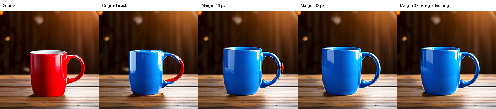
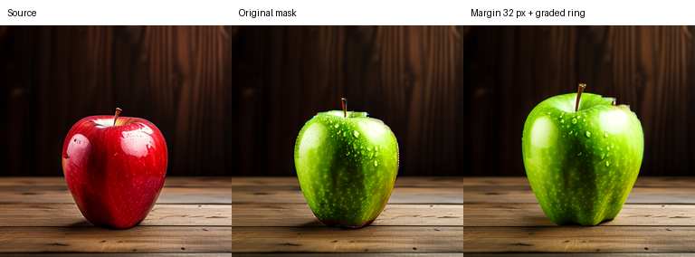
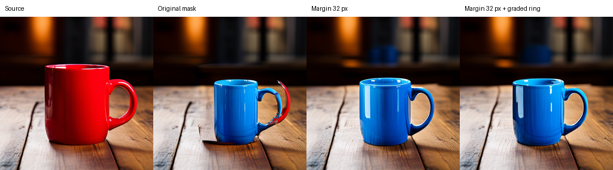

# MUTE: coverage and boundary development

Expanding the internally inferred edit mask removes visible red handle remnants
and greatly improves the mug boundary examples. The price is more background
change compared with zero-margin restoration. This is a restoration-mask coverage
result; no directional attention intervention is used in this sweep.

## Implementation

Added `--mask-margin` and `--mask-feather` to the restoration ablation. The former
dilates the editable core by a Chebyshev radius in transformer patches (16 output
pixels per patch). The latter adds graded outer rings. With feather width 1, its
single ring mixes target and source latents equally after each scheduler step.
Nearest-neighbor patch-to-latent upsampling stays fixed. Exact target/source
endpoints are preserved, and unchanged-source blending remains exact.

Mask options affect restoration only; directional attention still uses the
original localization. Defaults remain margin 0 / feather 0 for reproducibility.
Negative widths, mask options without restoration, nonfinite weights, and an
expansion leaving no protected background are rejected. Saved weights, editable
core/ring/protected counts and configuration are audited.

The image background metric uses the ORIGINAL source mask throughout. Expanded
editable cells therefore count as background changes if they were outside that
mask. The exact-latent invariant now applies only to weight-zero protected cells;
the original-mask background latents can change inside the new margin/ring.

## Image observations and selection

Seed-42 mug: margin 1 (16 pixels) removes most red and improves its rim but retains
a red sliver at the outer handle. Margin 2 (32 pixels) removes that visible remnant
and produces a much cleaner blue handle. Adding a graded ring looks similar and
does not establish a boundary-quality benefit. Margin 2 / feather 0 is the smallest
tested setting meeting the recorded visual criterion for this example. It is a
development choice, not a universal optimum or a new default.

The fixed margin-2/feather-1 transfer on the seed-123 mug removes the previously
doubled, partly red handle. There is a blue blurred patch in the background near
the expanded edit region. The apple transfer removes most visible edge remnants,
but grows/changes the apple's geometry. These observations are assistant judgments,
not external edit-success or boundary scores.
The separately selected margin-2/feather-0 setting also removes the visible
red/doubled handle on seed 123, while retaining the blue background patch. Its
fixed-mask background MAE is 0.029274, versus 0.012868 for zero margin and
0.148637 for ordinary generation. On seed 42 those values are 0.033345,
0.009501 and 0.131628 respectively. Thus cleaner coverage costs preservation
relative to zero margin, although both selected mug cases retain substantially
less background drift than ordinary generation (about 75% and 80% lower).

## Validation and next gate

Twelve tests pass, including exact dilation/ring geometry, weighted interpolation,
protected/active endpoints, exact unchanged-prompt identity, schedule checks and
the installed tiny PixArt callback integration. Each completed pretrained run is
audited for exact capture/source identities, finite full trajectories, saved mask
weights matching configuration, hashes, and zero protected final latent error.

Protocol and the separately documented post-selection transfer:
[coverage protocol](PROTOCOL_COVERAGE_DEVELOPMENT_2026-10-04.md).
Reproduce with `scripts/run_coverage_development.ps1`; contact sheets come from
`scripts/build_coverage_comparison.py`. Full settings and measurements:
[machine-readable record](reports/coverage_development_2026-10-04.json).

Next freeze a broader prompt/seed set and independent object masks plus explicit
success criteria: whole-object recoloring, geometry retention, boundary artifacts,
extra objects, and background preservation. Keep restoration-only with zero and
selected margins as baselines when reintroducing directional attention. Any gain
must survive those comparisons at comparable edit success before a contribution
is claimed. These development scenes have all been inspected; they cannot serve
as held-out evidence. No prior-method comparison or novelty is established.

## Fixed-mask diagnostic measurements

| Pair | Seed | Margin patches | Feather patches | Ordinary target MAE | Restored target MAE |
|---|---:|---:|---:|---:|---:|
| mug | 42 | 0 | 0 | 0.131628 | 0.009501 |
| apple_explicit | 42 | 0 | 0 | 0.177543 | 0.007166 |
| mug | 123 | 0 | 0 | 0.148637 | 0.012868 |
| apple_explicit | 42 | 2 | 1 | 0.177543 | 0.047837 |
| mug | 123 | 2 | 0 | 0.148637 | 0.029274 |
| mug | 123 | 2 | 1 | 0.148637 | 0.028089 |
| mug | 42 | 1 | 0 | 0.131628 | 0.026968 |
| mug | 42 | 2 | 0 | 0.131628 | 0.033345 |
| mug | 42 | 2 | 1 | 0.131628 | 0.033769 |

All six new runs pass exact capture and both ordinary/restoration-only unchanged-prompt identities (12 exact identities), finite complete trajectories, saved-weight checks and zero protected-background latent error. The original localization arrays and ordinary/source image hashes match their preceding baseline runs exactly. These are implementation checks; they do not establish boundary quality or semantic success. Background RGB MAE is normalized to 0–1 and uses the same original source mask within each pair/seed.
