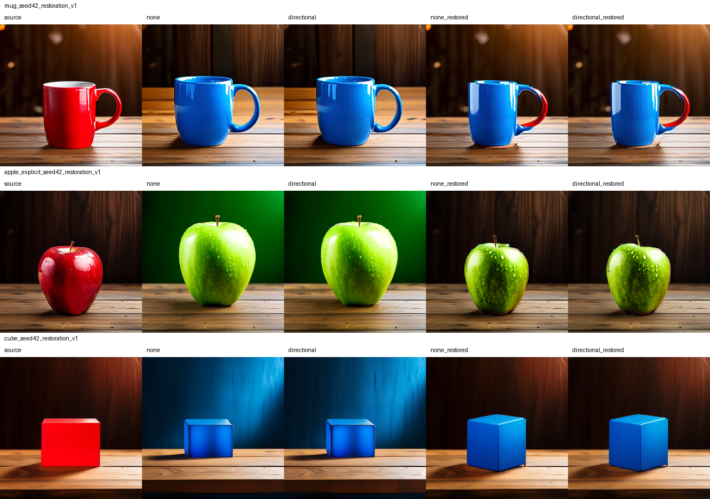
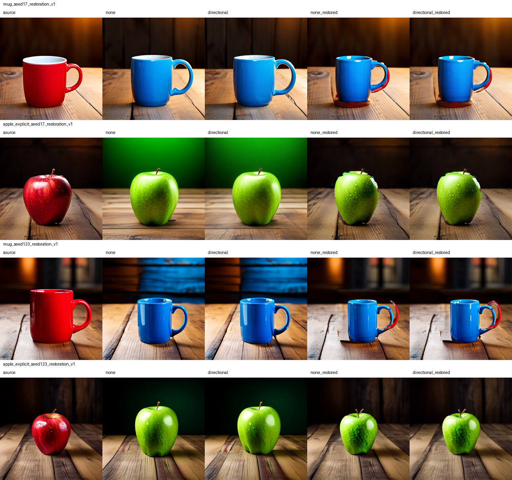

# MUTE: source-trajectory restoration

Background latent restoration produces a substantial visual preservation
improvement on the first-seed development examples while allowing visible object
color changes. Restoration alone is the strongest first-seed preservation
baseline. The combined directional variant still changes the active region and
causes more decoder spillover; these results do not establish a directional gain.

## What changed

The source run now records all 30 post-scheduler latent states. Each restored
target step replaces background latent cells with the matching source state.
The fixed inferred source patch mask is upsampled by nearest neighbor; active
latent cells retain their target values. This occurs before the next model call
and before the final VAE decode. No output RGB pixels are pasted into the result.

`--restore-background` adds restoration-only (`none_restored`) and combined
(`directional_restored`) variants alongside ordinary and directional-only runs.
Every variant also has an unchanged-prompt control. Restoration is a separate
mechanism; its benefit cannot be credited to directional attention.

The target DPM solver retains its own model-output history. This is post-step
latent replacement, not replay of the entire source solver state. The source
trajectory is saved on CPU in safetensors with exact timestep metadata and a hash.
The runner checks sequential callbacks, schedule/shape equality and finiteness.
It currently supports scheduler callback order 1 (DPM solver order 2 is compatible
because its callback order is 1). This is generated-source editing; there is no
real-image inversion.

## Image observations

Seed 42: the green apple keeps the original dark wooden background instead of
turning it green. The blue mug retains the original table and lighting, but part
of its handle stays red and its rim/body show artifacts. Its inferred mask misses
part of the handle. The blue cube keeps the original warm background, but changes
its visible geometry and has a small red remnant near its base.

These are assistant visual observations, not independent benchmark labels.
At seed 17 the apple also turns green against the original background, with red
remnants near its edge/base. The combined apple looks smoother at parts of the
outline; this subjective observation needs explicit boundary-quality scoring
before assigning a directional benefit. The seed-17 mug retains red at its
handle and base with both restored variants.
At seed 123 the mug's background remains close to the source, but the handle is
partly red and appears doubled/distorted. This is a substantial object-boundary
failure, not a clean successful edit. Reporting preservation alone would hide it.
The seed-123 apple also becomes predominantly green against the preserved dark
wooden background. Its shape and surface details still change. Across all seven
cases, restoration-only reduces inferred-mask background MAE by 86.14–95.96%
relative to ordinary target generation; this is not a matched-success benchmark.
Boundary quality and complete object coverage remain unresolved. A low background
MAE cannot establish successful recoloring, especially where restoration freezes
part of the object. The combined unchanged-prompt controls also reveal that
directional attention can disturb the foreground even when background latents
are restored exactly.

## Validation and reproducibility

Eleven tests pass, including selective restoration preserving active values,
schedule mismatch rejection, and the installed tiny PixArt pipeline callback.
With all latents restored, changed conditioning still decodes to the exact source.
With selective restoration and an unchanged prompt, the source remains exact.

Each completed pretrained run is audited by
`scripts/validate_restoration_runs.py`: exact capture equivalence, exact ordinary
and restoration-only source identities, image/trajectory hashes, a finite full
trajectory, and zero final background latent error under restoration. The last
property checks execution of replacement; it is not an independent quality metric.
VAE spatial coupling can change background pixels even when those latents match.
All first-seed source, ordinary, directional and corresponding non-restored
identity PNG hashes exactly match the preceding schedule implementation.

Use `scripts/run_restoration_development.ps1` to reproduce sequential mug/apple
batches from MUTE/ with the saved development conditioning bank. The seed-42 cube
uses the same configuration. Existing output directories are rejected.
`scripts/build_comparison.py` assembles the unmodified saved outputs for inspection.

The pinned model, 30 steps, guidance 4.5, threshold 0.3 and original capture settings
stay fixed. Directional attention starts at call 15 with penalty 2. Restoration
starts at call 0 and runs through the final call. See
[the protocol](PROTOCOL_RESTORATION_DEVELOPMENT_2026-10-04.md) and
[all measurements](reports/restoration_development_2026-10-04.json).

## Next decision

Keep restoration-only as the required preservation baseline. Test mask coverage
and boundaries with a separately recorded margin/feathering ablation; do not
quietly alter the mask after viewing results. Then freeze independent object masks,
held-out prompts/seeds and edit-success criteria before evaluating quality.
Only retain directional attention as a contribution if it improves edit quality
or preservation against restoration-only under matched successful edits.

These development prompts were selected after earlier pilot results. No prior
method comparison, significance test, held-out quality result or novelty claim
is established. All background image measurements below use the inferred source
mask, and runtime/memory observations are not isolated benchmarks.

## Diagnostic measurements

| Pair | Seed | Ordinary | Directional | Restoration only | Combined |
|---|---:|---:|---:|---:|---:|
| mug | 42 | 0.131628 | 0.126279 | 0.009501 | 0.018039 |
| apple_explicit | 42 | 0.177543 | 0.178899 | 0.007166 | 0.020296 |
| cube | 42 | 0.223376 | 0.222840 | 0.009500 | 0.014478 |
| mug | 17 | 0.082276 | 0.085273 | 0.011399 | 0.020466 |
| apple_explicit | 17 | 0.139376 | 0.131363 | 0.007689 | 0.017886 |
| mug | 123 | 0.148637 | 0.150589 | 0.012868 | 0.012710 |
| apple_explicit | 123 | 0.072799 | 0.077156 | 0.008218 | 0.020940 |

All seven runs pass capture equivalence and both ordinary/restoration-only identity controls (14 exact source identities). All 28 restored target/identity outputs have zero final background latent error. Image MAE is RGB normalized to 0–1 outside the inferred source mask. Restoration-only has lower background MAE than combined in six of seven cases; mug seed 123 is the exception. These values are diagnostic and do not measure complete recoloring or boundary quality.

