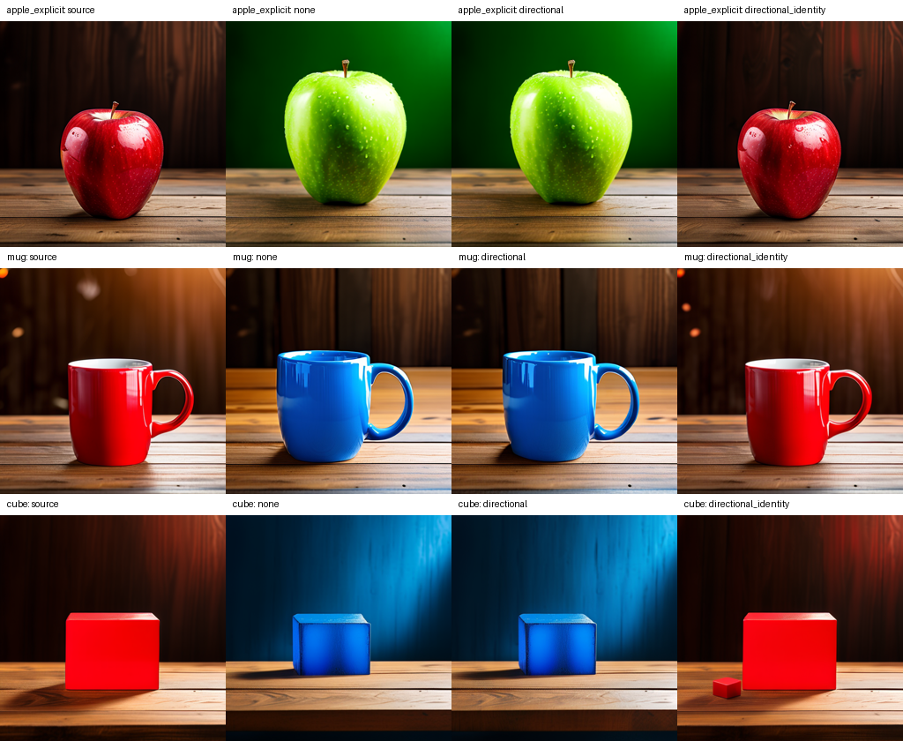

# MUTE: schedule and semantic-baseline development

Late, finite self-attention penalties reduce the severe artifacts from the first
hard-mask pilot. They have not established better preservation at successful edit
quality. We now have visible green-apple and blue-mug/cube baselines, so the next
experiment can measure preservation on edits that actually change the object.

## Implementation and validation

Added zero-based intervention start/end calls, positive finite logit penalties,
optional intervention layer selection, and unchanged-source-prompt controls.
Processor counters reset for each generation. Nine unit/integration tests pass,
including exact delegation outside the interval and partial influence under soft
penalties. The pretrained soft-late seed-42 run passes exact capture equivalence.
Every ordinary identity control must reproduce its source image exactly.

Freshly encoded original apple conditioning is tensor-for-tensor identical to
the previous cache, including masks and unconditional embeddings. Source and
target positive embeddings differ (mean absolute difference 0.06000648); their
unconditional embeddings match. This rules out a mismatched conditioning cache,
but does not prove every aspect of the pretrained loader is correct.

## What the images show

The original short green-apple prompt remains largely red. Increasing guidance
to 7.5 or 10 does not resolve it at seed 42. Explicit wording, "a bright green
apple with completely green skin on a wooden table", generates a green apple
with ordinary and late-soft directional attention. Both substantially alter the
apple's shape and turn much of the background green.

Red-to-blue ceramic mug and cube prompts also produce the requested colors with
both methods at seed 42. The mug's geometry, table, and lighting shift. The cube's
background turns blue and its geometry changes. The directional unchanged-prompt
cube control introduces an extra small red cube. These are assistant visual
observations, not independent annotations or benchmark success scores.

On the original apple, soft full-schedule intervention moves/shrinks objects and
its identity control adds another apple. Hard late intervention still introduces
an extra small fruit. Late soft intervention is much less disruptive visually,
but failed short-prompt color edits cannot count as preservation successes.

## Interpretation and next gate

Diagnostic background MAE (RGB normalized to 0–1, outside inferred source mask):

| Seed-42 condition | Ordinary target | Directional target | Directional unchanged prompt |
|---|---:|---:|---:|
| Original apple, hard late | 0.038457 | 0.042816 | 0.025189 |
| Original apple, soft full | 0.038457 | 0.097327 | 0.080727 |
| Original apple, soft late | 0.038457 | 0.039402 | 0.014889 |
| Explicit green apple, soft late | 0.177543 | 0.178899 | 0.014889 |
| Blue mug, soft late | 0.131628 | 0.126279 | 0.020967 |
| Blue cube, soft late | 0.223376 | 0.222840 | 0.015997 |

The original-apple soft-late repeats at seeds 17 and 123 remain largely red.
Their ordinary/directional target MAEs are 0.062226/0.065354 and
0.030621/0.038339 respectively. Directional identity disturbance is
0.023630 and 0.020986. All eight ordinary identity controls in this phase
exactly reproduce their sources. Small mug/cube MAE differences are descriptive
only; the cube's extra-object identity artifact illustrates the metric's limits.

All runs restart from the same seeded noise. They do not preserve a supplied real
image or replay a source denoising trajectory. A directional restriction alone
cannot guarantee that background queries or features stay equal to the source:
changed text conditioning and evolving latent states still affect them.

Next implement source-trajectory restoration as a separately named ablation:
cache the source latent at each scheduler step, restore background latent regions
after each target step, and compare ordinary, directional-only, restoration-only,
and combined variants with identical noise and settings. Verify an unchanged
prompt remains exact before evaluating changed prompts. Keep restoration distinct
from the directional hypothesis, and quantify whether it impairs edit success or
creates boundary artifacts. Start with the now-working mug and explicit apple;
define independent evaluation masks and freeze held-out prompts/seeds before any
quality or novelty claim.

Protocol: [development decisions](PROTOCOL_SCHEDULE_DEVELOPMENT_2026-10-04.md).
Full configurations, hashes, identity controls and diagnostic measurements:
[machine-readable results](reports/schedule_development_2026-10-04.json).

This is a development sweep selected after inspecting the earlier negative pilot.
Background RGB MAE uses inferred source masks, not independent masks. No matched
success advantage, significance, or novelty has been established. Timings are
not benchmarks; the GPU and memory were shared during parts of development.
The pinned official checkpoint and loader warning are documented in the earlier
[pretrained report](RESEARCH_STATUS_2026-10-04_PRETRAINED.md).
