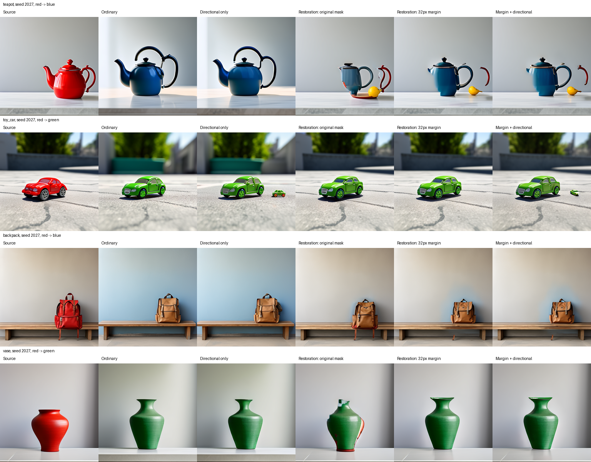
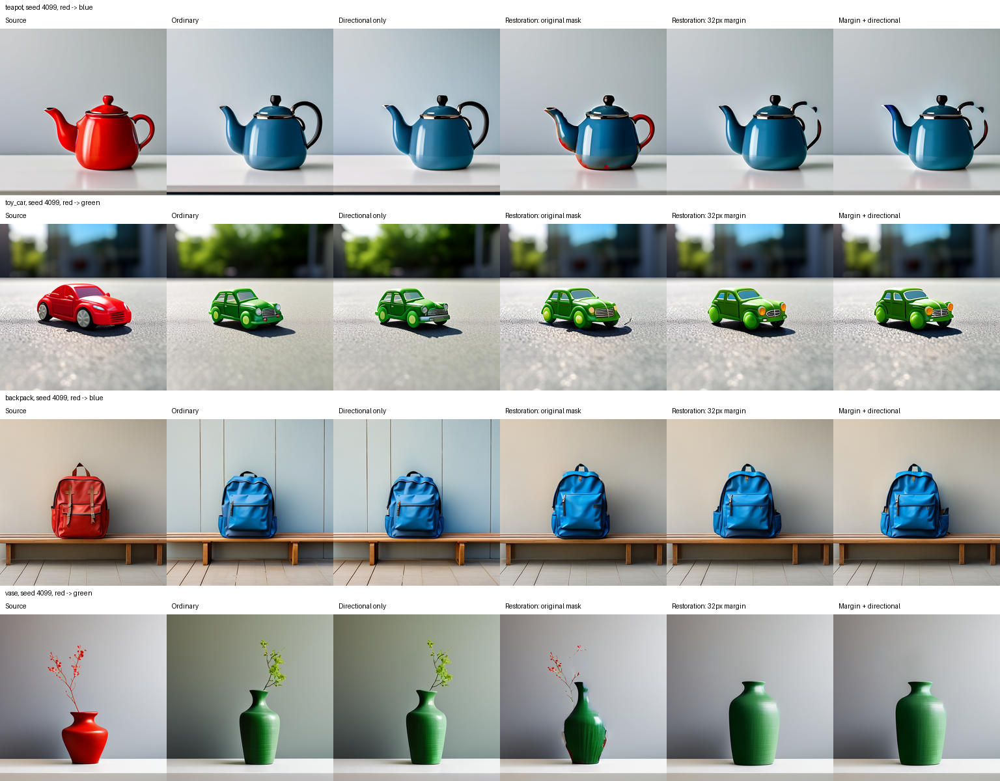

# Frozen evaluation v1 results

Restoration improves background preservation, but reliable whole-object recoloring and geometry retention are not established. Directional attention shows no clear added benefit in this eight-case screen.

Eight unseen prompt/seed cases, five variants, with frozen source-color masks independent of attention localization.
These are automated color-surface and geometry proxies, not independently rated semantic success or full-object annotations.

| Method | Cases | Proxy passes | Median color coverage | Median color-region IoU | Median background MAE |
|---|---:|---:|---:|---:|---:|
| Ordinary generation | 8 | 0 | 0.6475 | 0.5273 | 0.0819 |
| Directional attention only | 8 | 0 | 0.6635 | 0.5179 | 0.0870 |
| Restoration: original mask | 8 | 1 | 0.7501 | 0.6132 | 0.0071 |
| Restoration: 32px margin | 8 | 2 | 0.8112 | 0.5773 | 0.0163 |
| 32px restoration + directional | 8 | 2 | 0.8052 | 0.5742 | 0.0240 |

A proxy pass requires color coverage >=0.8, colored-region IoU >=0.7, centroid shift <=16 pixels, and background MAE <=0.03 simultaneously.
Invalid source masks and failed/missing runs do not pass and remain in all-case denominators. Medians use available valid-source rows; undefined centroids after failed recoloring are not imputed.
Background uses each frozen source-color mask dilated by 8 pixels, identical across methods. It is independent of the intervention mask but is not an independently annotated whole-object/background partition.
Target hue components may include colored background spillover. Thin, dark and white object parts may be missed. Geometry and boundary conclusions require source silhouette annotations and blinded target ratings.
This small screen supports descriptive comparisons only; no significance or novelty claim.

The two margin-2 proxy passes are teapot seed 4099 and backpack seed 4099. Inspection finds a broken/partly red handle on the teapot and changed pockets/straps/design on the backpack. Proxy passes must not be presented as validated clean same-object edits.
[Implementing assistant visual notes](../evaluation/frozen_v1/VISUAL_OBSERVATIONS.md) are explicitly not independent ratings. The reviewer packet contains blank ratings and 40 paired images with method names omitted; independent review remains pending.

[Frozen protocol](../evaluation/frozen_v1/protocol.json), [hash freeze](../evaluation/frozen_v1/freeze.json), [source mask freeze](../evaluation/frozen_v1/masks.json)
[Every case and metric](frozen_evaluation_v1.csv), [full machine record](frozen_evaluation_v1.json)

