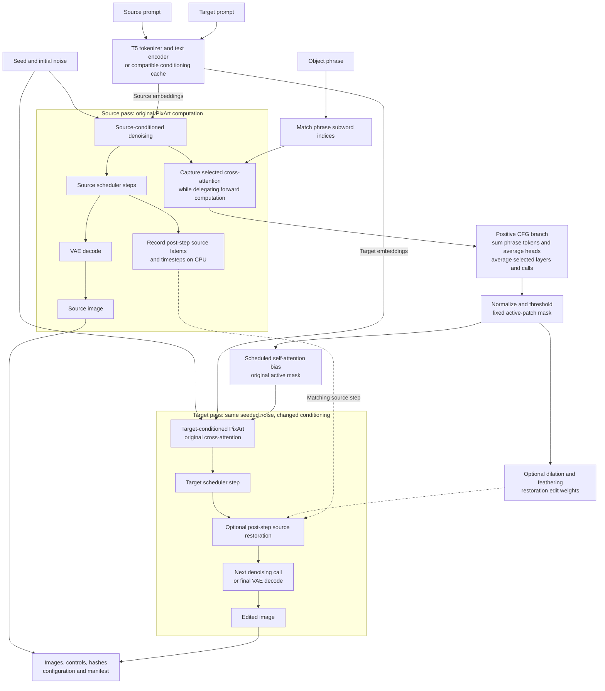
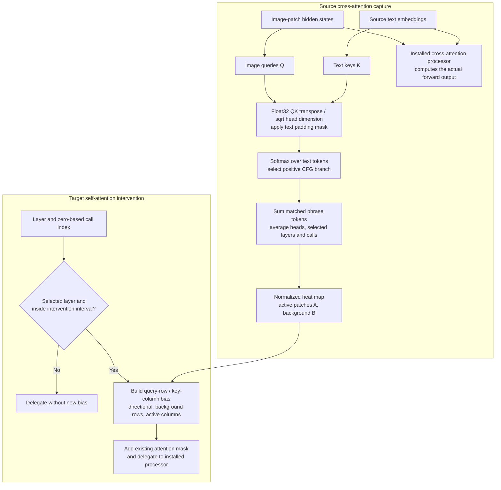
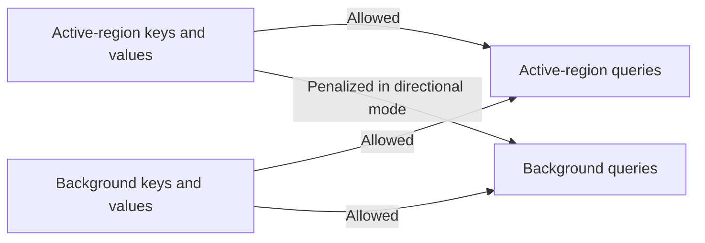
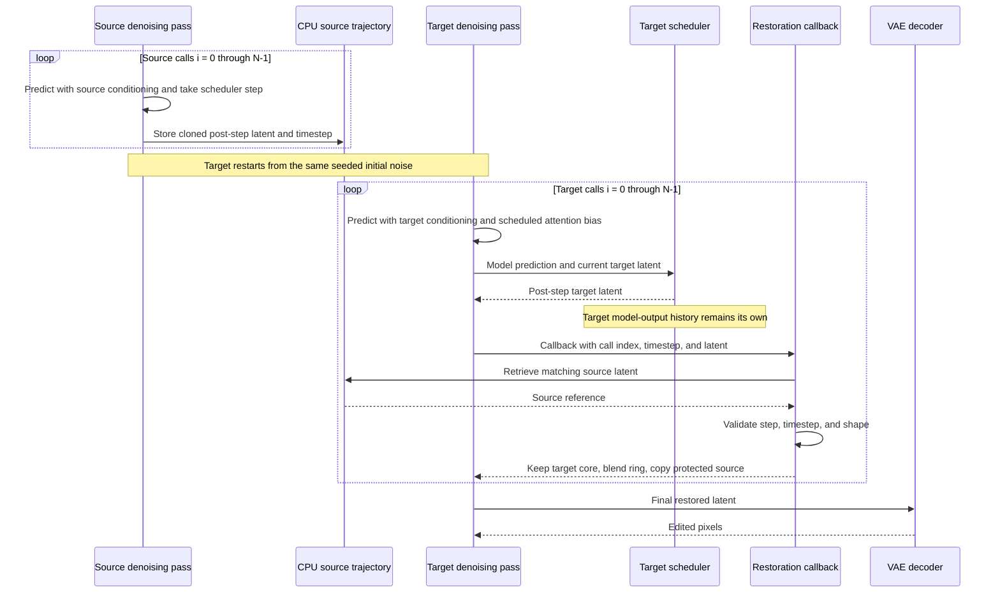
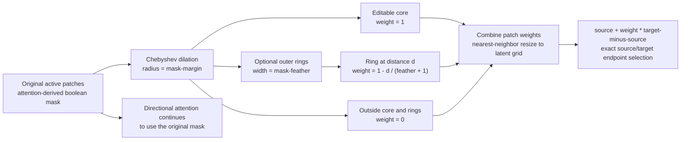
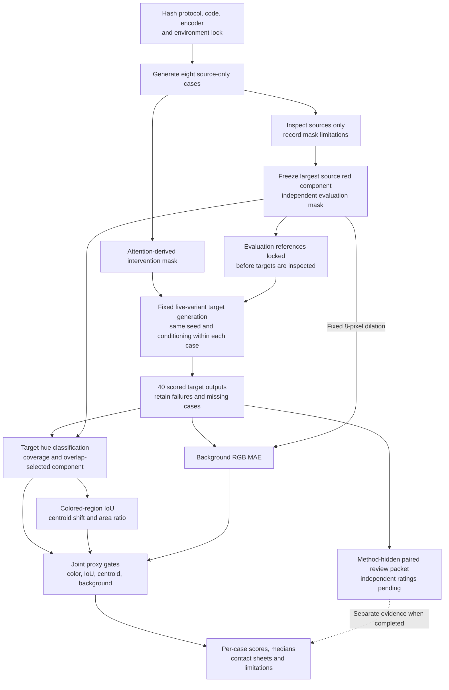
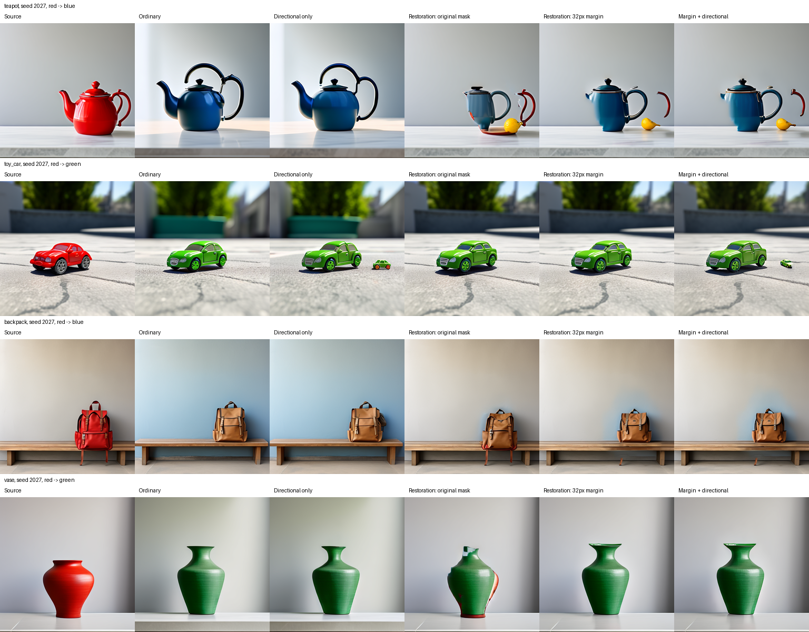
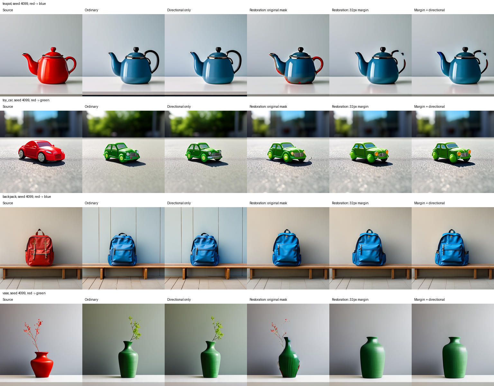

# MUTE — Mask-free Unified Token Editing

MUTE is an experimental inference-time editing pipeline built on **PixArt-alpha/PixArt-XL-2-512x512**. It derives an editable region from source-prompt cross-attention, tests directional self-attention, and optionally restores the background from a saved source denoising trajectory. It requires no hand-drawn editing mask and performs no model training or fine-tuning.

**Current finding:** source-trajectory restoration improves background preservation. Reliable whole-object recoloring and structure retention remain unresolved. Directional attention has not demonstrated a clear additional benefit over restoration alone. Novelty has not been established through a completed prior-method audit.

This root README is the canonical research guide; update it here rather than creating a duplicate in `MUTE/`.

This guide documents the controlled implementation and completed frozen evaluation as of **5 October 2026**. Earlier standalone scripts remain historical prototypes.

## Contents

- [Research question and scope](#research-question-and-scope)
- [How MUTE works](#how-mute-works)
- [Architecture diagrams](#architecture-diagrams)
- [Methods and controls](#methods-and-controls)
- [Repository map](#repository-map)
- [Environment and installation](#environment-and-installation)
- [Running experiments](#running-experiments)
- [Configuration reference](#configuration-reference)
- [Output artifacts](#output-artifacts)
- [Development history](#development-history)
- [Frozen evaluation v1](#frozen-evaluation-v1)
- [Results and interpretation](#results-and-interpretation)
- [Reproducing the frozen screen](#reproducing-the-frozen-screen)
- [Validation and troubleshooting](#validation-and-troubleshooting)
- [Limitations and next steps](#limitations-and-next-steps)
- [Research records and legacy code](#research-records-and-legacy-code)

## Research question and scope

The intended task is selective editing: change an object's requested attribute while retaining its geometry, parts, identity, and surrounding scene. For example, turn a red teapot blue while preserving its handle, spout, placement, counter, and wall.

MUTE investigates two separable mechanisms:

1. **Directional attention:** prevent background queries from reading editable-region keys during selected self-attention calls. The hypothesis is that this may limit propagation of the edit into the background.
2. **Source-trajectory restoration:** replace protected target latents with matching source latents after selected scheduler steps. This directly constrains background drift.

These mechanisms require separate ablations. An improvement caused by restoration does not establish that directional attention helped.

### Meaning of “mask-free”

The user provides prompts and an object phrase rather than drawing a spatial mask. Internally, MUTE creates an attention-derived spatial mask and optional restoration weights. “Mask-free” describes the editing interface; the algorithm still uses masks.

The frozen evaluation uses an additional source-color mask for measurement. It is independent of attention localization and does not control generation.

### Current task boundary

- Sources are generated images produced from a source prompt and seeded noise.
- Targets restart from the same seeded noise with a changed prompt.
- Restoration variants additionally reuse the saved source denoising trajectory.
- Source localization stays fixed during target generation.
- Arbitrary photograph inversion and editing are not implemented.
- Current experiments concern recoloring; general attribute, pose, removal, insertion, or 3D editing performance is not established.
- No MUTE/3D integration is implemented or evaluated here.

The evaluation loop runs inference and measurement. It **does not train the model, optimize weights, or automatically improve MUTE**.

## How MUTE works

### 1. Prepare source and target conditioning

The runner loads PixArt, tokenizes the selected phrase, and encodes both prompts. Phrase matching supports multiple subword tokens. Conditioning caches include compatibility metadata for the prompts, model, revision, guidance configuration, and dtype.

On the tested 8 GB GPU, the offload path encodes text before releasing the large text encoder and proceeds with transformer/VAE offload. Compatible cached conditioning avoids repeated text encoding.

### 2. Generate the source and capture cross-attention

Source generation records attention at explicitly selected transformer layers and denoising calls. Capture uses the positive classifier-free-guidance branch, honors text padding, calculates probabilities in float32, sums the selected phrase's token probabilities, and averages the selected records.

The capture processor delegates actual forward computation to the installed attention processor. With `--verify-capture`, an unwrapped source is compared against the captured source. Exact decoded pixel equality is required under the tested configuration.

### 3. Localize the editable region

The aggregated source attention map is min-max normalized and thresholded into active transformer patches. Degenerate maps or masks raise errors; there is no arbitrary patch fallback.

This is an attention estimate rather than guaranteed object segmentation. Handles, straps, shadows, highlights, and disconnected parts can be missed. The region is fixed during target generation.

### 4. Apply the target attention intervention

A self-attention bias restricts information flow according to the chosen direction. A finite positive penalty subtracts from selected logits; an infinite penalty applies hard blocking. Outside the intervention interval, the original processor is used.

Processor counters are reset before every generation so that the same schedule applies to targets and unchanged-prompt controls.

### 5. Optionally restore source latents

The source trajectory stores a CPU copy of every post-scheduler latent and its timestep. At a matching target step, restoration follows:

```text
restored = source + edit_weight × (target − source)

edit_weight = 0: copy the source latent exactly
edit_weight = 1: retain the target latent exactly
0 < edit_weight < 1: blend source and target
```

`--mask-margin` dilates the active core. `--mask-feather` adds graded outer rings. Expansion affects restoration only; directional attention retains the original active mask.

For this 512-pixel PixArt configuration, one transformer patch corresponds to 16 image pixels. Margin two gives a 32-pixel expansion radius around the active region.

Restoration occurs **after the scheduler step**. The target solver retains its own model-output history; this is not full source solver-state replay. Exact protected latent equality also does not guarantee identical decoded background pixels because the decoder can spread changes across boundaries.

### 6. Save controls and research artifacts

The runner saves images, localization, restoration weights, configuration, provenance, hashes, and applicable trajectory/identity checks. Errors become failed manifests. Evaluation measures recoloring, colored-region geometry, and background preservation together.

## Architecture diagrams

These diagrams describe the implemented inference pipeline. Solid arrows show data or control dependencies; dashed arrows identify optional paths or measurement checks. Source and target passes run sequentially and reuse the same pretrained model. They are not two separately trained networks.

### End-to-end source and target architecture



Attention localization and source latents serve different roles: localization defines where intervention is allowed, while the trajectory supplies the source values for protected regions. Expanding restoration coverage does not expand the directional-attention mask.

### Inside the attention processors



The capture branch observes source attention but does not substitute its reconstructed probabilities for the model's forward output. Target intervention modifies self-attention bias; it does not replace target text conditioning or target cross-attention with source text.

For self-attention, rows are **query destinations** and columns are **key/value sources**. An arrow below means that the destination query can read the source region:



The bias added to self-attention logits is `-penalty` for background-query/active-key pairs and zero elsewhere. Penalty 2 suppresses those pairs without removing them; infinity blocks them. Symmetric mode also penalizes active-query/background-key pairs, while reverse mode penalizes only that opposite direction. Directional blocking is an information-flow hypothesis, not a guarantee of preserved background pixels.

### Per-step trajectory restoration and solver state



The callback changes the latent used by the next target call. It does not replace the target scheduler's internal history with source history. Exact equality checks apply to protected latent positions; decoding can still alter nearby pixels.

### Restoration coverage construction



The ring formula means `1 - d / (feather + 1)`. For one feather ring, its weight is 0.5. Larger margins improve editable coverage but expose more of the scene to target drift; feathering blends values rather than guaranteeing a clean semantic boundary.

### Frozen evaluation architecture and data separation



The evaluation mask measures outputs; it does not supply the editing region. Source-only mask review precedes target inspection. Automated color-region gates and independent whole-object review are distinct evidence: proxy passes can still contain broken handles or changed designs.

## Methods and controls

| Variant | Attention behavior | Restoration | Purpose |
|---|---|---|---|
| Ordinary (`none`) | Original processor | No | Same-noise prompt-change baseline |
| Directional | Background queries cannot read active keys | No | Test the proposed information-flow direction |
| Symmetric | Block both directions across the boundary | No | Development control |
| Reverse | Active queries cannot read background keys | No | Opposite-direction control |
| Restoration-only (`none_restored`) | Original processor | Yes | Isolate the source-trajectory effect |
| Combined (`directional_restored`) | Directional bias | Yes | Measure added value over restoration alone |

Frozen v1 compares ordinary, directional, original-mask restoration, margin-two restoration, and margin-two restoration plus directional attention. Symmetric and reverse remain available for development but are outside that screen.

`--identity-controls` repeats methods with the unchanged source prompt. Ordinary and restoration-only identities must reproduce the source exactly. Directional identities measure disturbance from the intervention and are not assumed to be exact.

## Repository map

```text
Repository root/
├── README.md                      Canonical research documentation
├── .venv/                         Isolated local environment
└── MUTE/                          Working directory for experiment commands
    ├── mute/
    │   ├── run.py                 CLI, loading, generation, controls, manifests
    │   ├── attention.py           Capture, localization, attention interventions
    │   ├── trajectory.py          Source recording and restoration weights
    │   └── evaluation.py          Frozen evaluation proxies
    ├── tests/                     Unit and tiny-pipeline integration checks
    ├── scripts/                   Download, batch, audit, and report tools
    ├── evaluation/frozen_v1/      Protocol, hashes, masks, archived source images
    ├── reports/                   Curated scores and visual comparisons
    ├── checkpoints/               Large local model files; ignored
    ├── runs/                      Raw outputs, caches, and logs; ignored
    └── requirements*.txt          Dependencies and recorded Windows lock
```

| Script | Role |
|---|---|
| `download_pixart.py` | Resumable pinned checkpoint download |
| `encode_development_bank.py` | Reusable prompt embeddings; supports protocol-driven encoding |
| `run_restoration_development.ps1` | Sequential restoration development batch |
| `run_coverage_development.ps1` | Sequential margin/feather development batch |
| `run_frozen_evaluation.py` | Freeze, sources, targets, and scoring stages |
| `prepare_frozen_replay.py` | Verify/restore archived references and prepare conditioning |
| `validate_restoration_runs.py` | Audit hashes, identities, trajectories, and protected latents |
| `summarize_runs.py` | Summarize experiment manifests |
| `build_comparison.py` / `build_coverage_comparison.py` | Development contact sheets |
| `build_frozen_report.py` | Frozen metrics exports and contact sheets |
| `build_frozen_review.py` | Paired review images and blank ratings sheet |

## Environment and installation

### Recorded environment

| Component | Tested value |
|---|---|
| OS / shell | Windows / PowerShell |
| Python | 3.14.7 |
| PyTorch | 2.14.0+cu130 |
| Torchvision | 0.29.0+cu130 |
| Diffusers | 0.40.0 |
| Transformers | 5.18.0 |
| Accelerate | 1.15.0 |
| NumPy | 2.5.3 |
| GPU | RTX 5060 Laptop, approximately 8 GB VRAM |
| Checkpoint variant | fp16 |
| Generation runtime dtype | bfloat16 |

The environment does not inherit host site packages. These are recorded experimental versions, not a guarantee of compatibility with every driver, OS, or Python version. Timing and memory measurements on shared hardware are diagnostics rather than controlled performance benchmarks.

### Create the isolated environment

From the repository root, where this README lives:

```powershell
python -m venv .venv
.\.venv\Scripts\python.exe -m pip install -r MUTE\requirements_windows.lock.txt
```

Use the recorded Python version when reproducing the frozen experiment. `requirements_windows.lock.txt` records the complete environment. `requirements_cuda_windows.txt` specifies the Windows CUDA build and includes the smaller model-library requirements.

Then enter the implementation directory:

```powershell
Set-Location MUTE
..\.venv\Scripts\python.exe -c "import torch; print(torch.__version__); print(torch.cuda.is_available())"
..\.venv\Scripts\python.exe -m mute.run --help
..\.venv\Scripts\python.exe -m unittest discover -s tests -v
```

### Download the pinned checkpoint

```powershell
..\.venv\Scripts\python.exe scripts\download_pixart.py --output checkpoints\pixart512
```

- Model: `PixArt-alpha/PixArt-XL-2-512x512`.
- Immutable revision: `50f702106901db6d0f8b67eb88e814c56ded2692`.
- Completed local checkpoint: approximately 12.14 GB.
- Provenance: `source.json`; the completed download verified SHA-256 hashes for the four large LFS files.

Allow extra disk space for download chunks, conditioning, source trajectories, and output images. The resumable downloader retains chunk data, which increases disk usage. After downloading, use the local model path with `--local-files-only`.

## Running experiments

All following commands run from `MUTE/`. Every experiment needs a new output directory; the runner refuses to overwrite an existing directory.

### Controlled recoloring with restoration

```powershell
..\.venv\Scripts\python.exe -m mute.run `
  --model checkpoints\pixart512 `
  --local-files-only --offload `
  --source "a red ceramic mug on a wooden table" `
  --target "a blue ceramic mug on a wooden table" `
  --phrase mug --seed 42 --steps 30 --guidance 4.5 `
  --modes none directional `
  --intervention-start 15 --penalty 2 `
  --restore-background --mask-margin 2 --mask-feather 0 `
  --verify-capture --identity-controls `
  --output runs\mug_example_new
```

This produces the source, ordinary target, directional target, restored variants, and unchanged-prompt controls. Inspect the individual images and manifest alongside the comparison. A blue mug with a changed handle or silhouette is still a structure-preservation failure.

These settings come from development. They differ from some CLI defaults and are not established as universally optimal.

### Source-only inspection

```powershell
..\.venv\Scripts\python.exe -m mute.run `
  --model checkpoints\pixart512 --local-files-only --offload `
  --source "a red ceramic mug on a wooden table" `
  --target "a blue ceramic mug on a wooden table" `
  --phrase mug --seed 42 --source-only --verify-capture `
  --output runs\mug_source_review_new
```

Source-only mode finishes before edited targets. It supports source review and independent evaluation-mask preparation without looking at target results.

### Conditioning reuse

Supply `--conditioning-cache` with a compatible cache saved by this runner. Metadata must match the prompts, model, revision, guidance configuration, and dtype. Do not substitute embeddings from a different experiment merely because their tensor shapes match.

## Configuration reference

| Argument | Default / interpretation |
|---|---|
| `--model` | PixArt Hugging Face identifier; use the pinned local path for recorded experiments |
| `--revision` | Optional immutable revision for remote loading |
| `--variant` | `fp16` checkpoint weights |
| `--source` / `--target` | Red apple / green apple on a wooden table |
| `--phrase` | `apple`; phrase localized from source cross-attention |
| `--seed` | `42`; shared initial-noise seed |
| `--steps` | `30` |
| `--guidance` | `4.5` |
| `--capture-steps` | `5 10 15`; zero-based capture calls |
| `--layers` | `6 12 18 24`; capture layers |
| `--threshold` | `0.3`; normalized attention threshold |
| `--modes` | Choose `none`, `directional`, `symmetric`, `reverse` |
| `--intervention-start` | `0`; first intervention call |
| `--intervention-end` | Optional exclusive end |
| `--penalty` | Infinity by default; finite positive values soften blocking |
| `--intervention-layers` | Optional self-attention layer subset |
| `--restore-background` | Add restored variants for requested modes |
| `--restoration-start` / `--restoration-end` | Start `0`; optional exclusive end |
| `--mask-margin` | `0`; core dilation radius in transformer patches |
| `--mask-feather` | `0`; additional graded ring width in patches |
| `--verify-capture` | Require unwrapped/captured source pixel equality |
| `--identity-controls` | Repeat with unchanged source prompt |
| `--source-only` | Finish after source/localization preparation |
| `--conditioning-cache` | Compatible saved embeddings |
| `--device` | `cuda`; `cpu` is also available |
| `--dtype` | `bfloat16`; also `float16` and `float32` |
| `--offload` | Memory-saving loading/inference path |
| `--local-files-only` | Require locally available model files |
| `--output` | Required new output directory |

Schedules count zero-based denoising calls; end values are exclusive. The frozen protocol defines its own exact settings. Generic CLI defaults do not redefine the frozen experiment.

## Output artifacts

Depending on enabled options, a run saves:

| Artifact | Meaning |
|---|---|
| `source.png` | Captured source generation |
| `source_original.png` | Unwrapped source for capture verification |
| `none.png`, `directional.png`, etc. | Target generation variants |
| `*_restored.png` | Variants with source restoration |
| `*_identity.png`, `*_restored_identity.png` | Unchanged-prompt controls |
| `attention.png` | Phrase attention heat map |
| `mask.png`, `localization_overlay.png` | Original inferred region |
| `localization.npz` | Numerical heat map and active patches |
| `restoration_weights.png`, `restoration_weights.npz` | Expanded/feathered weights |
| `source_trajectory.safetensors` | Post-step source latents and timestep metadata |
| `conditioning.safetensors` | Prompt embeddings when produced by the run |
| `comparison.png` | Labeled visual comparison |
| `manifest.json` | Configuration, status, provenance, checks, timings, hashes |

Manifest diagnostics include background RGB MAE using the inferred region. This differs from the independent frozen-v1 measurement; do not mix these diagnostics into the frozen result table.

Large weights and raw outputs are ignored by version control. Curated reports, protocols, evaluation masks, and archived source references preserve the portable research record.

## Development history

| Stage | Investigation | Finding |
|---|---|---|
| Controlled pretrained checks | Three development seeds; exact capture checks; hard attention modes | Capture preserved source pixels; hard masks damaged images |
| Schedule/penalty development | Late intervention, finite penalties, identity controls, explicit prompts | Softer intervention reduced severe artifacts; wording affected edits; superiority remained unproven |
| Source restoration | Apple/mug repeats and cube case; separate restoration ablations | Background drift decreased markedly; coverage and boundary failures remained |
| Coverage development | Margin and feather settings on inspected cases | Margin two improved mug handle coverage but increased drift and geometry changes |
| Frozen broader screen | Four new objects, two unused seeds, five variants | Restoration helped preservation; only 1–2 of eight cases passed joint proxies; structure failures persisted |

Earlier examples were inspected while choosing settings and cannot be presented as held-out evidence.

## Frozen evaluation v1

### Cases and fixed settings

Eight cases combine four objects with seeds **2027** and **4099**:

| Object | Source scene | Edit |
|---|---|---|
| Teapot | Red ceramic teapot, white kitchen counter, plain gray wall | Red → blue |
| Toy car | Red toy car, gray concrete pavement, daylight | Red → green |
| Backpack | Red backpack, beige wooden bench, plain gray wall | Red → blue |
| Vase | Red ceramic vase, white pedestal, plain gray wall | Red → green |

Exact prompts are in [protocol.json](MUTE/evaluation/frozen_v1/protocol.json). Settings are 512-pixel generation, 30 steps, guidance 4.5, bfloat16 runtime, threshold 0.3, capture calls 5/10/15, and layers 6/12/18/24. Directional intervention starts at call 15 with penalty 2. Restoration runs for all 30 steps with no feathering.

Five scored variants produce **40 target rows**. Source generations, identity controls, and duplicated baselines are additional audit artifacts rather than additional independent cases.

### Freeze procedure

1. Hash protocol, generation/metric code, runner, encoder, and environment lock before source generation.
2. Generate all sources without targets.
3. Inspect source-only overlays, derive evaluation masks, and freeze their hashes.
4. Run fixed target variants while retaining failures.
5. Score every case and prepare visual comparisons and review materials.

The evaluation mask is the largest four-connected red HSV component in the source, independent of attention localization. Numerical validity requires at least 256 pixels and at most 60% image area. All eight sources passed these checks; this does not imply complete object segmentation.

Mask omissions were documented before targets. Dark parts, highlights, wheels, straps, and disconnected handles can be absent from the color mask.

### Metrics and joint gates

| Metric | Definition | Limitation |
|---|---|---|
| Color coverage | Fraction of source-mask pixels classified as target color | Misses parts outside that mask |
| Colored-region IoU | Source-mask overlap with target-color component having greatest source overlap | Measures colored surfaces, not full silhouette |
| Centroid shift | Source/target colored-region centroid distance in pixels | Does not guarantee shape or part retention |
| Area ratio | Target/source colored-region area | Similar area can conceal design changes |
| Background RGB MAE | Normalized RGB error outside source mask dilated by 8 pixels | Can conceal small added/removed scene elements |

HSV requires saturation ≥0.25 and value ≥0.1. Hue ranges are red [0, 0.06] or [0.94, 1], blue [0.52, 0.72], and green [0.20, 0.46]. These were frozen before inspecting targets.

A **joint proxy pass** requires all four conditions:

```text
Color coverage       ≥ 0.80
Colored-region IoU   ≥ 0.70
Centroid shift       ≤ 16 pixels
Background RGB MAE   ≤ 0.03
```

Area ratio is reported but is not a gate. Invalid sources and failed/missing runs cannot pass and remain in the all-case denominator. Undefined centroids are not imputed. A proxy pass is not an independently verified clean-edit label.

## Results and interpretation

| Method | Proxy passes | Median color coverage | Median colored-region IoU | Median background MAE |
|---|---:|---:|---:|---:|
| Ordinary generation | 0/8 | 0.6475 | 0.5273 | 0.0819 |
| Directional only | 0/8 | 0.6635 | 0.5179 | 0.0870 |
| Restoration, original mask | 1/8 | 0.7501 | 0.6132 | 0.0071 |
| Restoration, 32px margin | 2/8 | 0.8112 | 0.5773 | 0.0163 |
| 32px restoration + directional | 2/8 | 0.8052 | 0.5742 | 0.0240 |

All 40 rows were scored with no execution failures. Eight cases support descriptive comparison, not statistical significance or broad benchmark claims.

### Supported conclusions

- Restoration substantially lowers background MAE in this screen.
- Expanded restoration increases median recoloring coverage relative to original-mask restoration while allowing greater background drift.
- Directional-only generation does not pass the joint gates.
- Combined restoration/directional attention does not clearly outperform expanded restoration alone; its median background MAE is higher.
- Reliable same-object structure retention remains unresolved.

### Failures missed by aggregate scores

Margin-two restoration and combined methods pass proxies for teapot 4099 and backpack 4099. The teapot still has a broken/partly red handle. The backpack changes pockets, straps, material, or design. These proxy passes are not validated clean edits.

Other observed failures include changed vehicle geometry/wheels, extra small cars, partial recoloring, deformed teapot parts, brown rather than blue backpack output, jagged boundaries, and removed vase flowers. Small background MAE can coexist with a meaningful scene-content failure.

[Visual observations](MUTE/evaluation/frozen_v1/VISUAL_OBSERVATIONS.md) were written by the implementing assistant and are **not independent ratings**. Forty paired review images and a blank ratings sheet are prepared; independent review is pending.

See the [full report](MUTE/reports/FROZEN_EVALUATION_V1.md), [per-case CSV](MUTE/reports/frozen_evaluation_v1.csv), [machine-readable results](MUTE/reports/frozen_evaluation_v1.json), and [audit record](MUTE/reports/frozen_evaluation_v1_audit.json).





## Reproducing the frozen screen

After preparing the recorded environment and pinned checkpoint, run from `MUTE/`:

```powershell
..\.venv\Scripts\python.exe scripts\prepare_frozen_replay.py
..\.venv\Scripts\python.exe -u scripts\run_frozen_evaluation.py targets
..\.venv\Scripts\python.exe scripts\build_frozen_report.py
..\.venv\Scripts\python.exe scripts\build_frozen_review.py
```

The curated `evaluation/frozen_v1/source_archive/` contains byte copies of the original eight sources, their unwrapped capture controls, and manifests. These are the references hashed before target generation. Preparation verifies existing references or restores missing files without overwriting differing ones and encodes missing conditioning.

The target runner checks frozen hashes and source-image identity. Existing complete/failed groups are retained rather than silently replaced. The review builder refuses to overwrite an existing packet to preserve entered ratings.

Exact reproduction depends on runtime/hardware behavior. If images differ under another environment, report the discrepancy rather than replacing references while calling the result the original experiment.

**Keep v1's frozen files unchanged.** These cases have now been inspected and may be used for subsequent development. A changed method requires a new version and fresh frozen evaluation cases. Do not regenerate `freeze.json` merely to make modified code pass the v1 checks.

The [frozen protocol guide](MUTE/evaluation/frozen_v1/README.md) explains the replay contract. Ratings are stored in `runs/evaluation_v1/blinded_review/ratings.csv`; the method mapping is separate in `reports/frozen_review_mapping.json`.

## Validation and troubleshooting

### Completed validation

The implementation checkpoint records **15 passing unit/integration tests**, covering directional bias, capture delegation, schedules, finite penalties, tiny PixArt pipeline behavior, conditioning, trajectory matching, margin/feather weights, exact restoration endpoints, and evaluation failure cases.

The frozen screen additionally passed:

- 24 exact source capture checks across source-only and target groups.
- 32 exact ordinary/restoration-only unchanged-prompt identities.
- 48 protected-latent equality checks on restored outputs.
- Image/trajectory hashes, finite trajectories, and restoration-weight/configuration checks.
- Source equality and duplicated ordinary baseline equality across margins.

These checks establish implementation behavior under tested settings, not semantic editing quality.

### Common issues

| Symptom | Action / interpretation |
|---|---|
| CUDA unavailable | Check the isolated Torch build and driver compatibility |
| GPU memory exhaustion | Use `--offload`, run sequentially, and coordinate GPU usage |
| Local model missing | Finish download before using `--local-files-only` |
| Output directory rejected | Use a new directory and preserve the prior run |
| Degenerate phrase localization | Inspect prompt, token matching, and attention; retain the failure rather than forcing patches |
| Nonfinite values or black output | Investigate dtype/runtime; do not count the output as a successful edit |
| Frozen hash mismatch | Restore the frozen version or create a new protocol version |
| Exact latents but changed nearby pixels | Decoder spillover can alter pixels across boundaries |
| Correct color but changed shape | This remains an editing-quality failure |
| Blank review ratings | Independent review has not yet been completed |

The recorded loader emitted an unused `caption_projection.y_embedding` notice, and the scheduler emitted a NumPy deprecation warning. Successful loading does not establish equivalence with an original-author implementation.

## Limitations and next steps

The main unresolved problem is retaining the same object while changing color. Background MAE and color coverage alone do not capture handle integrity, pockets, wheels, material, or identity.

Next research priorities:

1. Improve foreground structure retention and thin/disconnected-part coverage on development cases.
2. Add full source silhouette annotations and complete independent paired ratings for semantic success, parts, boundaries, extra objects, and background spillover.
3. Maintain restoration-only versus combined ablations and require repeatable added value before treating directionality as a contribution.
4. Audit closest prior methods before claiming novelty or choosing a paper contribution.
5. Freeze fresh cases after method changes, with a larger evaluation and clear development/test separation.
6. Define separate implementation/evaluation protocols for real-image inversion, broader edits, or eventual 3D integration.

No MUTE model weights have been trained. This record does not establish state-of-the-art quality, benchmark-level generalization, novelty, or completed 3D integration.

## Research records and legacy code

| Record | Content |
|---|---|
| [Implementation plan](MUTE/IMPLEMENTATION_PLAN.md) | Milestones and implementation checkpoints |
| [Pretrained protocol](MUTE/PRETRAINED_PROTOCOL_2026-10-04.md) / [results](MUTE/RESEARCH_STATUS_2026-10-04_PRETRAINED.md) | Initial controlled pretrained checks |
| [Schedule protocol](MUTE/PROTOCOL_SCHEDULE_DEVELOPMENT_2026-10-04.md) / [results](MUTE/RESEARCH_STATUS_2026-10-04_SCHEDULE.md) | Intervention schedule/penalty development |
| [Restoration protocol](MUTE/PROTOCOL_RESTORATION_DEVELOPMENT_2026-10-04.md) / [results](MUTE/RESEARCH_STATUS_2026-10-04_RESTORATION.md) | Source restoration ablations |
| [Coverage protocol](MUTE/PROTOCOL_COVERAGE_DEVELOPMENT_2026-10-04.md) / [results](MUTE/RESEARCH_STATUS_2026-10-04_COVERAGE.md) | Margin/feather experiments |
| [Frozen protocol guide](MUTE/evaluation/frozen_v1/README.md) | Freeze and reproduction rules |
| [Source-mask review](MUTE/evaluation/frozen_v1/SOURCE_MASK_REVIEW.md) | Limitations recorded before edited targets |
| [Frozen results](MUTE/reports/FROZEN_EVALUATION_V1.md) | Completed broader evaluation |

Earlier `run_dynamic_*.py`, `run_soundproof_*.py`, `debug_*.py`, and `custom_attention.py` files remain historical experiments and debugging tools. Their short runs and saved images do not establish editing quality or preservation. Use `python -m mute.run` for the controlled pipeline.

When sharing results, identify the model revision, code/protocol version, method, prompt/seed, controls, and metric definition. Present proxy scores alongside visible failures and pending independent review.
